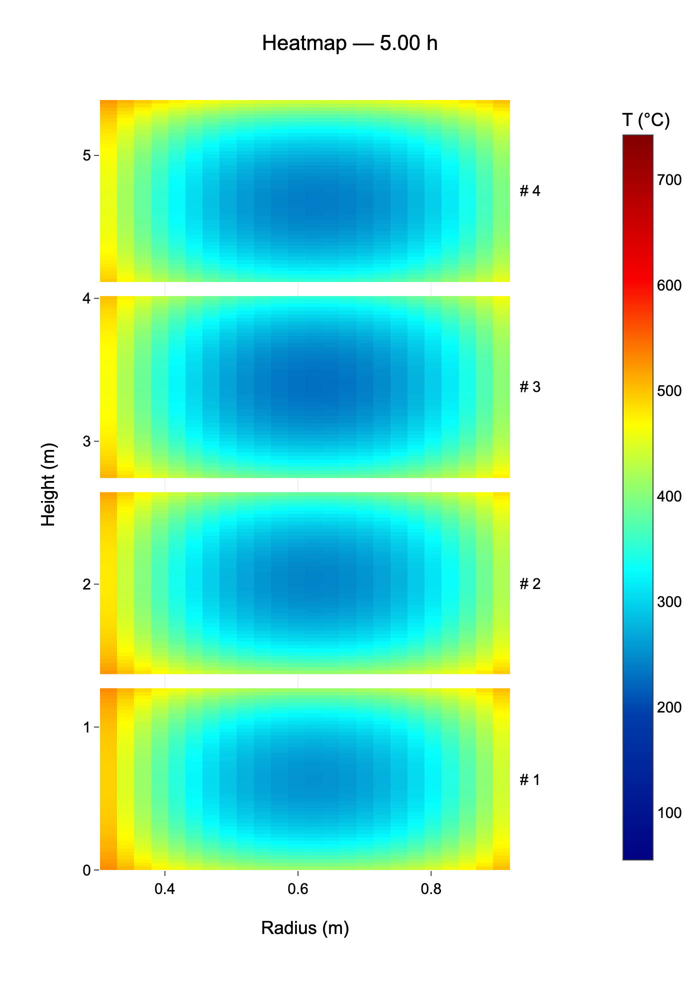

# Heat Transfer Model for Annealing in Bell-Type Furnaces

heattransfer models the thermodynamic interactions between the protection gas and the coil during an annealing process. Only convection between the p. g. and the coils was considered, disregarding radiation as argued by Yang et al.


## Results

Radial–vertical temperature distribution of the four coils, exported from the saved
output of `four_coil_test.ipynb` at 5 hours. Coil 1 is at the bottom; temperatures are in °C.



## Project structure

The project strucutre is as follows: 

- `heattransfer/models/`: furnace, coil, material, and protective gas models.
- `heattransfer/physics/`: conduction, convection, and area calculations.
- `heattransfer/simulator.py`: time integration and coil region calculations.
- `heattransfer/analysis/`: result extraction and plotting.
- `data/experimental/`: experimental CSV measurements.
- `tests/`: automated simulation tests.
- `config/requirements.txt`: Python dependencies.
- `docs/`: project documentation and references.
- `.cache/legacy/`: preserved generated files from the previous layout.

For quick testing use `four_coil_test.ipynb`.

Run commands from the project root:

```bash
python -m pip install -r config/requirements.txt
python -m unittest discover -s tests -v
```

Example imports:

```python
from heattransfer.simulator import Simulator
from heattransfer.models.furnace import Furnace
from heattransfer.analysis.analyzer import Analyzer
```

## Compact results and parallel execution

The axisymmetrical solver stores each coil as a `(height, radius, time)` array. For the four-coil notebook,
full-history storage is approximately 38.8 MiB.

`run()` returns one 3D array for a single coil, or a list for multiple coils.
Timesteps remain sequential within each coil. The process mode is valid because
the current model prescribes the gas temperature and does not couple coil results.
Workers use the spawn start method and importable module-level functions, so the
provided notebook can call process mode directly. Custom model objects must be
picklable. For standalone Python scripts, use a main guard:

```python
if __name__ == "__main__":
    results = simulator.run(parallel=True, max_workers=4)
```

`max_workers=1` and single-coil simulations execute locally without a process pool.
Process startup and result transfer add overhead, so short runs may be faster serially.
The parent process receives only compact histories; no shared-memory cleanup is needed.

## Steel properties

The temperature-dependent correlations from Taylor and Wang (2017, Equations 26 and 27) are used for thermal conductivity and specific heat, respectively. See `experiments/hydrogen_effect_comparison.ipynb` for more information.

## Reference hydrogen properties

`ReferenceHydrogen` in `heattransfer.models.protection_gas` implements the same gas
property interface using CoolProp HEOS: Leachman et al. (2009) density, Assael et al.
(2011) conductivity, and Muzny et al. (2013, with the 2022 erratum) viscosity.
Density-dependent terms are included. Install with
`pip install -r config/requirements-properties.txt`.

Leachman, J. W., Jacobsen, R. T., Penoncello, S. G., & Lemmon, E. W. (2009). Fundamental equations of state for parahydrogen, normal hydrogen, and orthohydrogen. *Journal of Physical and Chemical Reference Data, 38*(3), 721–748. https://doi.org/10.1063/1.3160306

Assael, M. J., Assael, J.-A. M., Huber, M. L., Perkins, R. A., & Takata, Y. (2011). Correlation of the thermal conductivity of normal and parahydrogen from the triple point to 1000 K and up to 100 MPa. *Journal of Physical and Chemical Reference Data, 40*(3), 033101. https://doi.org/10.1063/1.3606499

Muzny, C. D., Huber, M. L., & Kazakov, A. F. (2013). Correlation for the viscosity of normal hydrogen obtained from symbolic regression. *Journal of Chemical & Engineering Data, 58*(4), 969–979. https://doi.org/10.1021/je301273j

Muzny, C. D., Huber, M. L., & Kazakov, A. F. (2022). Erratum: Correlation for the viscosity of normal hydrogen obtained from symbolic regression. *Journal of Chemical & Engineering Data, 67*, 2855. https://doi.org/10.1021/acs.jced.2c00523

## Reference List

Yang, X.-j., Dai, F.-x., Bao, X.-j., Chen, G., Zhang, L., & Li, Y.-r. (2025). Study of heat transfer model and buried thermocouple test of bell-type annealing furnace based on thermal equilibrium. Scientific Reports, 15, Article 13362. https://doi.org/10.1038/s41598-025-97422-4

Zhang, H., Zhang, J., Cao, J., Jing, Y., & Wu, C. (2005). Heat transfer efficiency of inner covers with different shapes in a bell-type annealing furnace [English translation of the original Chinese title]. Journal of University of Science and Technology Beijing, 27(5), 532–535. https://doi.org/10.13374/j.issn1001-053x.2005.05.036

Ltd, G. S. C. (2023, September 28). SPCC Steel Properties - Knowledge - GNEE Steel. https://www.gneeppgi.com/info/spcc-steel-properties-53015712.html

Alfa-Tech – Quality Steel. (2026, October 21). Thermal conductivity of steel and metals – λ coefficient. Alfa-Tech – Quality Steel, Stainless Steel, Heat-Resistant Steel, Special Steel. https://www.alfa-tech.com.pl/en/physical-properties-of-steel-and-metals/thermal-conductivity/


Taylor, S. W., & Wang, S. (2017). Modelling steel strip heating within an annealing furnace. *Pacific Journal of Mathematics for Industry, 9*, Article 5. https://doi.org/10.1186/s40736-017-0030-7
